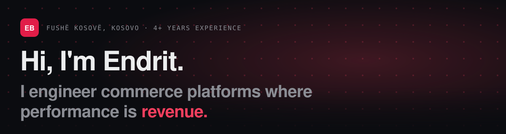

<!-- Styled profile README for github.com/endritbejta
     Design tokens taken from endritsportfolio.netlify.app:
     bg #0b0c10, text #ecedee, muted #8b8d94, accent #f43f5e (rose).
     Needs assets/banner.svg in the same repo. -->

  
  
  

For four years I have owned four production commerce storefronts end to end at **GRENION Brands** in Berlin — Banana Beauty, HelloBody, MyRapunzel and Sophie Rosenburg — covering architecture, delivery, performance and reliability. Liquid, TypeScript and React across three theme codebases, plus headless work with Hydrogen.

I came to software from electrical engineering: managing infrastructure projects at KEDS taught me to think in systems, constraints and failure modes first.

> Most of my day-to-day work lives in private and company repositories, so this profile is a partial view. The public projects are below.

 

<code><b>WORK</b></code>

## Featured projects

<table>
  <tr>
    <td width="50%" valign="top">
      <code>2026</code>
      <h3>Shitblej</h3>
      
A peer-to-peer marketplace for second-hand goods in Kosovo, replacing Facebook-group trading with searchable listings, graded conditions and a server-enforced offer-to-order flow.

      <ul>
        <li>Offer → counteroffer → checkout → order, enforced on the server</li>
        <li>Real-time buyer/seller messaging over Socket.IO</li>
      </ul>
      
      
      
       
      <a href="https://endritsportfolio.netlify.app">Case study →</a>
    </td>
    <td width="50%" valign="top">
      <code>2026</code>
      <h3>Alfa Rent a Car</h3>
      
A car-rental platform with a public booking site and an admin dashboard on one codebase, where the database itself rejects overlapping reservations so a car can never be double-booked.

      <ul>
        <li>Fleet browsing, car details and online booking</li>
        <li>Admin dashboard for vehicles, reservations and customers</li>
      </ul>
      
      
      
       
      <a href="https://endritsportfolio.netlify.app">Case study →</a>
    </td>
  </tr>
  <tr>
    <td width="50%" valign="top">
      <code>2026</code>
      <h3>WindowSwitcher</h3>
      
A native macOS menu-bar app that gives Command+Tab Windows-style behaviour: every window is its own entry, in most-recently-used order, with a live thumbnail.

      <ul>
        <li>Live thumbnail and app icon per window</li>
        <li>A quick tap flips between your two most recent windows</li>
      </ul>
      
      
       
      <a href="https://endritsportfolio.netlify.app">Case study →</a>
    </td>
    <td width="50%" valign="top">
      <code>2026</code>
      <h3>Minimalist E-commerce</h3>
      
A storefront whose pricing, cart and checkout rules live in plain, unit-tested modules instead of components, so the logic can be tested without rendering anything.

      <ul>
        <li>Collections, product pages, cart drawer, one-page checkout</li>
        <li>Framework-free business logic covered by Vitest</li>
      </ul>
      
      
      
       
      <a href="https://endritsportfolio.netlify.app">Case study →</a>
    </td>
  </tr>
</table>

 

<code><b>TOOLBOX</b></code>

## Stack

  

 

<code><b>ACTIVITY</b></code>

## GitHub

  
  

 

  <code>Open to software engineering roles across frontend and commerce platforms · endrit.bejta@hotmail.com</code>

